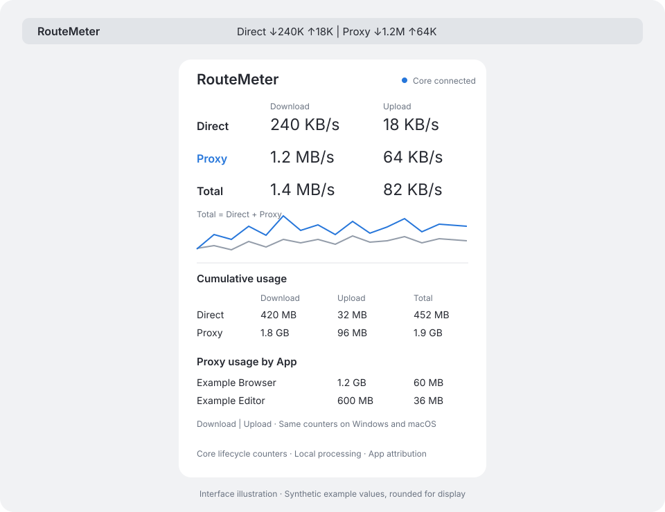

# RouteMeter

Native **Windows and macOS** viewers for per-App **Proxy** usage, with **Direct / Proxy / Total** and explicit **Download / Upload** counters.

[中文说明](docs/README.zh-CN.md) · [Downloads](https://github.com/MatchalatteR/RouteMeter/releases) · [Core setup](docs/CORE-SETUP.md) · [Protocol](docs/PROTOCOL.md)



## How accurate metering works

**RouteMeter Core must be in the actual traffic path.** It is a separately distributed, modified Mihomo core with lifecycle metering at the routing adapter. The native viewers read its authenticated, read-only loopback API.

- A completed short connection remains counted even if it starts and ends between screen refreshes.
- TCP, UDP and fast I/O paths contribute to cumulative counters in the core.
- Direct/Proxy comes from the actual final adapter type, not a node/group name, TUN interface, or destination-country guess.
- OS-backed process lookup runs at connection creation. Missing or ambiguous owners stay **Unattributed**.
- macOS helpers in one outer `.app` bundle group under that App; Windows identities use case-normalized full executable paths. Different executables with the same filename are not merged.
- App counters reconcile with core totals. Unknown routing, uncertain buffered writes, overflow and persistence failures are explicit.

The counters measure **application payload handled by this core**. They do not claim encrypted wire/ISP billing accuracy, traffic bypassing the core, recovery from every crash/power loss, or retrospective classification of another proxy's traffic. The viewer never guesses an App to hide missing attribution.

## Install and connect

Download the matching release ZIP: Windows x64, macOS Apple Silicon, or macOS Intel. Windows packages include a self-contained .NET viewer and RouteMeter Core. macOS packages contain the native app and a Core helper.

1. Start the included **RouteMeter Core** with your private Mihomo-compatible routing configuration.
2. Route the intended applications through that core's actual HTTP/SOCKS/TUN inbound. Verify the routing before replacing an existing daily VPN/proxy.
3. Open RouteMeter, choose **Connect Core…**, and select `<core-home>/route-meter/connection.json`.
4. Open **Proxy usage by App**. Choose cumulative usage or live rates; filter by App name as needed.

See [complete setup and measurement boundaries](docs/CORE-SETUP.md). The viewer does not change system proxy settings, DNS or routes. TUN/global routing is a separate deployment step and can require elevation. Merely running an observer next to QX cannot recover the missing connection ownership.

**Requirements:** macOS 14+; Windows 10/11 x64 for the native Windows package. An Intel cross-build is not an Intel hardware acceptance test. See [validation](docs/VALIDATION.md) and the current Actions run for actual coverage.

The macOS app retains **QX legacy totals** compatibility. That mode supports aggregate Direct/Proxy counters only. Per-App Proxy attribution requires RouteMeter Core.

Initial distributions are ad-hoc signed on macOS and are not Developer ID notarized; the Windows binaries do not yet have an Authenticode certificate. OS download protections can apply. Build from reviewed source if your environment requires it; no security protection needs to be disabled by RouteMeter.

## Reading the display

- Menu/tray indicators: `↓` = Download, `↑` = Upload, in bytes per second; K/M/G use 1024-based units.
- Direct and Proxy are separate cumulative/rate buckets. **Total = Direct + Proxy + Unknown routing**; the Unknown row is shown when needed.
- Each cumulative row's Total is Download + Upload.
- **Proxy usage by App** includes only the Proxy bucket, with visible Unattributed usage when ownership is unavailable.
- Reset changes only this viewer's baseline. It does not erase core totals or another viewer's history.
- Core restarts retain persisted totals and change the instance ID. Invalid saved data creates a visibly flagged new epoch and preserves the unreadable file.

The core normally checkpoints every second and flushes on normal shutdown. A forced stop can lose data since the last successful checkpoint; slow/failing storage can extend that interval. Rate displays are derived from cumulative snapshots. A missed UI refresh affects rate timing, not completed-flow cumulative accounting.

## Privacy

The core stores executable/App identity and byte counters under `<core-home>/route-meter/`. It does not store destination IPs/domains, URLs, HTTP headers or payloads in its meter state. The core's own optional diagnostic/controller logging is controlled separately by your Mihomo configuration.

The meter service binds only to IPv4 loopback on a random port. Its private connection file supplies a random read credential. Only authenticated reads of usage are supported; the service cannot edit routes or configuration. There is no telemetry or cloud account. The viewer's Setup guide button opens this public repository.

Unix meter folders/files are private. Windows applies a private ACL to the meter folder. This is not a boundary against the same OS user or an administrator. Do not share connection files, credentials, private routing configs, executable paths, or unredacted screenshots in public issues.

QX legacy data and viewer preferences remain under `~/Library/Application Support/RouteMeter/`; the Windows viewer keeps its local baseline/preferences under `%LOCALAPPDATA%\RouteMeter`.

## Build and test

The viewers have no third-party Swift/.NET UI package dependencies. The core uses the pinned Mihomo source and its locked Go dependencies.

```sh
# macOS viewer (Command Line Tools); full Xcode is needed for XCTest
swift build --build-system native
swift test --build-system native

# Core: Go 1.27.3 and Python 3, immutable upstream revision + local patch
./scripts/build-core.sh
(cd engine/meter && go test -race ./...)

# Real core, exact TCP/UDP payloads, closed short flows, OS owners,
# persistence and native viewer JSON/HTTP compatibility; all loopback
python3 scripts/test-core-integration.py dist/core/darwin-arm64/RouteMeterCore \
  --viewer "$(swift build --build-system native --show-bin-path)/RouteMeter"

./scripts/package.sh arm64
```

On Windows, build the core from Git Bash (`PYTHON=python ./scripts/build-core.sh windows amd64`), then run `./scripts/package-windows.ps1` from PowerShell. The Windows native viewer targets .NET 8; the release includes its runtime. The CI workflow provides exact clean-runner commands for both OSes.

Tests use temporary private folders, free loopback ports, synthetic routing configs and local mock upstreams. They do not use a personal subscription, change system proxy settings or send test counters to an existing widget.

## Stop and uninstall

Quitting a viewer leaves the routing core running. Stop a console core with Ctrl+C only when you intend to stop that proxy service. Preserve `<core-home>/route-meter/` to retain totals. Remove the app and local viewer preference/data folders when uninstalling.

For an old QX-only installation, disable its RouteMeter QX task and optional launch-at-login item before removing the old app. The new Core mode does not need access to QX request logs or a QX HTTP Backend.

## License and source

Original macOS/Windows viewer code is [MIT](LICENSE). **RouteMeter Core and its metering additions are GPL-3.0**, with notices and a complete patched corresponding-source archive next to release binaries. See [component notices](THIRD-PARTY-NOTICES.md) and [core source/build instructions](docs/CORE-SOURCE.md). Quantumult X is not included or affiliated with this project.

[Contributing](CONTRIBUTING.md) · [Security](SECURITY.md)
